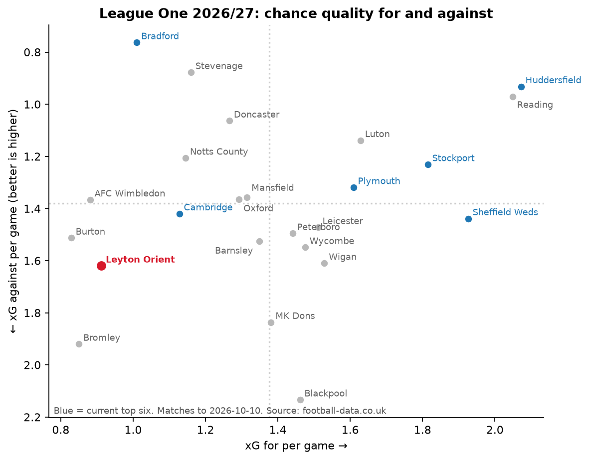
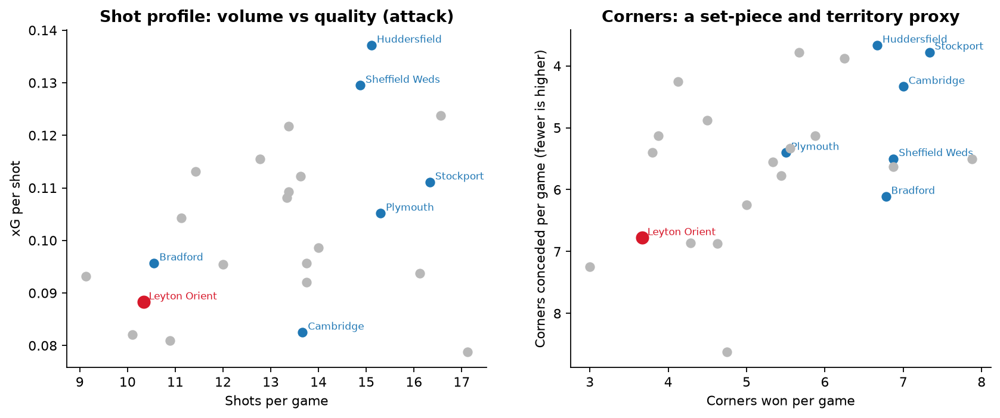
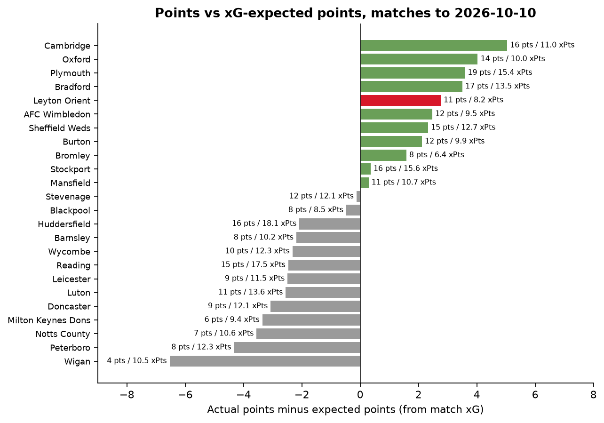
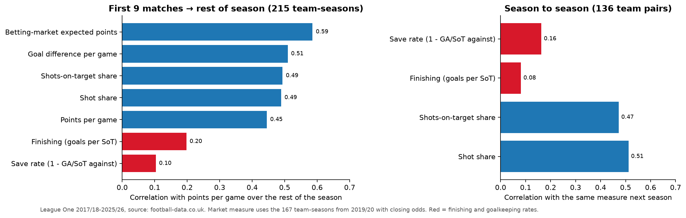
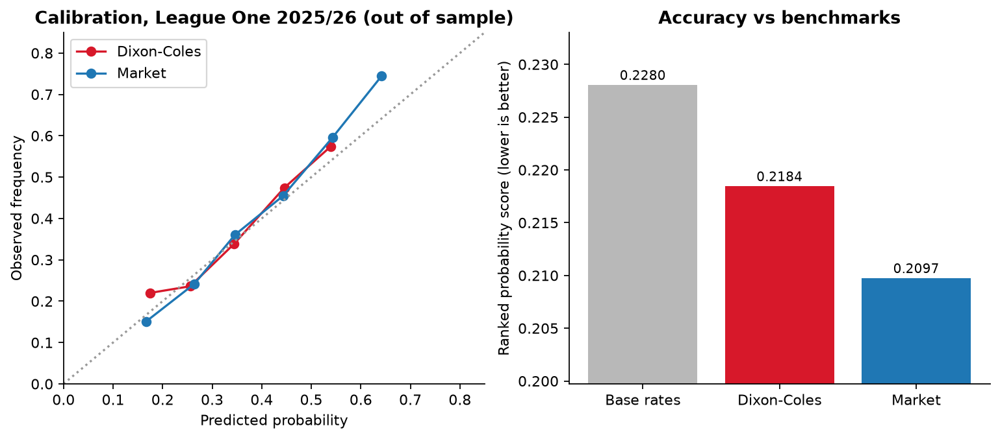

# Leyton Orient: Post-Match Briefing and 2026/27 Performance Review

**An analyst-style briefing on Leyton Orient built entirely from free, legally usable data: a post-match report on Orient 2-0 Blackpool (17 Oct 2026), a season-so-far review using match xG, nine seasons of League One history to show what actually drives points, and a validated Dixon-Coles model to project the rest of 2026/27.**

*Anthony Adusei-Poku · MSc Data Science, University of East London (2025)*

   

📄 **Two-page staff briefing (PDF): [`reports/Leyton_Orient_staff_briefing_2026-10-19.pdf`](reports/Leyton_Orient_staff_briefing_2026-10-19.pdf)** · Markdown version: [`reports/briefing.md`](reports/briefing.md)

<p align="center"></p>

## TL;DR

* **Post-match, Orient 2-0 Blackpool (Sat 17 Oct 2026):** Orient won with **37.7% possession** and **3 corners to 11**, but had **6 shots on target to 4** and missed **3 big chances to 0**. It was their second clean sheet in a row, after a 0-0 at Bradford in which Bradford had **no shots on target**.
* **The table flatters the process.** Orient are **9th on 14 points** (4W 2D 4L, goals 15-11, table to 17 Oct). But across the 9 matches with xG data (to 10 Oct) they rank **23rd of 24 on xG difference** (−0.71 a game). They scored **13 goals from 8.2 xG** and conceded **11 from 14.6 xG**, so their **11 points compare with 8.2 expected points**.
* **The risky kind of over-performance.** Points are being held up by finishing (0.39 goals per shot on target) and saves (0.73 save rate), both above the League One top-six average. Across **215 League One team-seasons (2017/18 to 2025/26)**, those two rates barely carry over from one season to the next (r = 0.08 and 0.16). Shot-on-target share does carry over (r = 0.47), and Orient's is **45%**.
* **What would most improve results:** a regression of points on shots on target (R² = 0.67) values cutting the shots on target Orient concede to the top-six level (4.56 → 3.41 a game) at **about +14 points a season**. Matching top-six creation (3.67 → 4.69) is worth about +12.
* **Context:** Orient's 6th place in 2024/25 (78 points) came with a 53% share of shots on target. That fell to 45% in 2025/26 (20th, 52 points), when they also took only **0.87 points a game from matches level at half-time** (league average 1.32).
* **Model and projection:** a time-weighted **Dixon-Coles** model fitted across the Championship, League One and League Two was tested out of sample on all 552 League One matches of 2025/26. Its ranked probability score was **0.2184**, against 0.2280 for base rates and 0.2097 for the bookmakers' closing odds. Simulating the rest of 2026/27 10,000 times gives Orient **63 points on average, a 10% chance of the top six and a 4% chance of the bottom four**.

## 1. Data: what is freely and legally available?

League One event data (shot locations, passes, set-piece tags) is sold commercially (Opta, StatsBomb, Wyscout) and is not openly licensed, and sites that display it generally forbid scraping. So I first checked what can actually be used:

| Source | What it gives | Coverage used | How obtained |
|---|---|---|---|
| [football-data.co.uk](https://www.football-data.co.uk/englandm.php) | Free CSVs: results, half-time scores, shots, shots on target, corners, fouls, cards, bookmaker odds. **New for 2026/27: match xG (`HxG`, `AxG`)** | League One 2017/18 to 2026/27 (4,918 matches with stats); League Two from 2019/20 and Championship from 2022/23 (used only for the match model) | `src/download_data.py` (direct file downloads that the site offers for free use) |
| [Sky Sports match stats](https://www.skysports.com/football/leyton-orient-vs-blackpool/stats/7079498450254119232) | Team stats for Orient 2-0 Blackpool | 1 match | Typed in by hand: [`manual/`](manual/README.md) |
| [Football Web Pages](https://www.footballwebpages.co.uk/league-one/fixtures-results/october) | League One scores, 15-17 Oct 2026 | 12 matches | Typed in by hand: [`manual/`](manual/README.md) |

* The 2026/27 football-data.co.uk file was downloaded on **19 Oct 2026** and runs to **10 Oct 2026** (102 matches). The 12 later results bring the table up to **17 Oct 2026**. That table matches the official Sky Sports League One table of 19 Oct 2026 exactly, for every team.
* **About the xG column:** football-data.co.uk's `notes.txt` does not yet say who supplies it, so I treat it as indicative. It behaves sensibly: team xG correlates with shots on target (r = 0.64) and with shots (r = 0.68), and League One's total of 294 goals is close to its 280.7 xG.
* **Cross-check between providers:** for Bradford 0-0 Orient, football-data.co.uk and Sky Sports agree on shots on target (0 and 1) and corners (11 and 2). Sky counts one more Bradford shot (10 v 9).
* I did not use FBref, Understat, Sofascore, FotMob or any undocumented API. They either don't cover League One with xG, or their terms forbid scraping.

> Data from football-data.co.uk, used with thanks. Raw CSVs are not included in this repository; `python src/download_data.py` recreates them.

## 2. Post-match: Leyton Orient 2-0 Blackpool (Saturday 17 October 2026)

Goals: Will Forrester 31' (a header from Alex Gilbert's cross) and Dane Scarlett 76' (penalty). Attendance 8,055.

<p align="center"></p>

* **Out of possession by design.** Orient attempted 271 passes to Blackpool's 446. Blackpool had 26 touches in Orient's box to 16 and won 31 aerial duels to 18.
* **Efficient when they did attack.** Orient put 6 of their 14 shots on target and missed 3 big chances. Blackpool missed no big chances and scored none, so by that definition they created none. Joseph Olowu's header hit the bar just before the penalty.
* **Watch-point: corners.** Orient conceded 11 corners here and 11 at Bradford a week earlier. Across the season they win 3.7 a game (23rd of 24) and concede 6.8 (20th).
* **Context from Bradford (A, 0-0, 10 Oct):** football-data.co.uk has Orient's xG at 0.34 and Bradford's at 1.25, with Bradford held to 0 shots on target.

## 3. Season so far

<p align="center"></p>

| | Orient | League One rank (of 24) |
|---|---:|---:|
| Points (table to 17 Oct) | 14 from 10 | 9th |
| xG difference per game (9 matches to 10 Oct) | −0.71 | 23rd |
| xG for / against per game | 0.91 / 1.62 | 21st / 21st |
| Shots for / against per game | 10.3 / 15.2 | 22nd / 19th |
| xG per shot (attack) | 0.088 (league 0.104) | 20th |
| Corners won / conceded per game | 3.7 / 6.8 | 23rd / 20th |

* The 5-0 win at Bromley (1.67 xG) supplies 4 of the 13 goals. Leave it out and Orient scored 8 goals from 6.5 xG. The defensive over-performance (3.6 goals fewer than xG) runs through the whole season.
* **Home and away:** 8 points from 4 away games (goals 8-1), but 6 points from 6 home games (goals 7-10).
* **Set pieces:** the free data has corner counts but does not show which goals came from set pieces, so this is a volume view only (below, right).

<p align="center"></p>

## 4. Are the results sustainable?

<p align="center"></p>

Expected points use each match's two xG values, with Poisson goals for each side. Orient's **+2.8 points over xPts** is the 5th largest over-performance in the division. The betting market priced their 9 games at **11.0 expected points**, exactly their haul. xG over nine games is noisy, and the market sees a mid-table squad.

**What has predicted the rest of a League One season?** I took the first 9 matches of all 215 team-seasons from 2017/18 to 2025/26 and correlated each measure with points per game over the remaining matches:

<p align="center"></p>

| Early-season measure (first 9 games) | Correlation with points per game for the rest of the season |
|---|---:|
| Betting-market expected points (167 team-seasons, from 2019/20) | 0.59 |
| Goal difference per game | 0.51 |
| Shots-on-target share / shot share | 0.49 / 0.49 |
| Points per game | 0.45 |
| Finishing (goals per shot on target) | 0.20 |
| Save rate | 0.10 |

Orient's 2026/27 profile has a weak signal (a 45% share of shots on target) propped up by the two noisiest measures.

## 5. Three seasons of context

<p align="center"></p>

| Season | Pos | Pts/game | Shots for | Shots against | SoT share | Goals per SoT | Save rate | Corners against |
|---|---:|---:|---:|---:|---:|---:|---:|---:|
| 2023/24 | 12th | 1.41 | 11.9 | 10.5 | 50.8% | 0.285 | 0.694 | 4.8 |
| 2024/25 | 6th | 1.70 | 11.3 | 10.5 | 53.2% | 0.371 | 0.719 | 4.2 |
| 2025/26 | 20th | 1.13 | 11.2 | 12.1 | 44.9% | 0.347 | 0.660 | 4.9 |
| 2026/27 (9 games) | 9th* | 1.22 | 10.3 | 15.2 | 44.6% | 0.394 | 0.732 | 6.8 |
| Top-six average, 2017/18-2025/26 | | 1.85 | 13.1 | 10.2 | 58.0% | 0.349 | 0.705 | 4.5 |

\*Table position after 10 games, to 17 Oct. Positions are computed from results and ignore any points deductions.

**Game state.** League One teams average 1.32 points a game from matches level at half-time. Orient took 1.55 (2023/24), 1.28 (2024/25) and **0.87 in 2025/26** (23 matches, about 10 points below average). In 2026/27 they have won all three matches they led at half-time.

## 6. What would most improve results?

<p align="center"></p>

OLS on 215 League One team-seasons: **points per game = 1.454 + 0.248 × SoT for − 0.269 × SoT against** (both per game; R² = 0.674; 95% CIs 0.202 to 0.295 and −0.313 to −0.224). Adding finishing and save rates lifts R² to 0.913, which shows how much of a single season's table comes down to those two volatile rates.

* On current rates (3.67 for, 4.56 against) the model expects **1.14 points a game, about 52-53 points over 46 games**.
* Each extra shot on target a game is worth about **+11.4 points a season**. Each one fewer conceded is worth about **+12.4**.
* Closing the defensive gap to the top six would add **+14.2 points a season**, and closing the attacking gap **+11.7**. The two are linked: Orient concede territory (15.2 shots and 6.8 corners against a game), so the defensive gain probably comes from keeping the ball further up the pitch, not just from defending the box better.

## 7. Match model and season projection

`src/model.py` implements a **time-weighted Dixon-Coles model**. Each team has attack and defence ratings and there is one home-advantage term. Matches are down-weighted with a 240-day half-life, a ridge penalty (0.25) shrinks thinly observed teams, and the Dixon-Coles ρ corrects low-scoring results.
The model is fitted on **Championship, League One and League Two matches together since 2022/23**, so promoted and relegated clubs carry their ratings across divisions. I chose the half-life and penalty by walk-forward testing on 2024/25 (refitting every 14 days on past matches only), then tested once on 2025/26:

| League One 2025/26, 552 matches, walk-forward | Log loss | RPS | Accuracy |
|---|---:|---:|---:|
| Base rates (2024/25 home/draw/away) | 1.0670 | 0.2280 | 46.0% |
| **Dixon-Coles (scores only)** | **1.0405** | **0.2184** | **48.6%** |
| Betting market (average closing odds, overround removed) | 1.0153 | 0.2097 | 50.9% |

<p align="center"></p>

The model is well calibrated and closes about half the gap between naive base rates and the market. The market also prices team news, injuries and transfers that scores alone can't see. The fitted home advantage is ×1.22 on expected goals.

**Projection from 18 Oct 2026 (10,000 simulations of the 438 unplayed fixtures):**

<p align="center"></p>

* Orient: **62.7 points on average** (80% range 53-72), median finish **13th** (80% range 6th-18th), **10.3% top six**, 1.2% top two, **4.2% bottom four**.
* The model rates Orient 14th, because it reads goals and Orient's goal difference (+4) beats their xG difference. If the xG picture is right, this outlook is, if anything, generous.

**Next three fixtures (model probabilities):**

| Date | Fixture | Orient win | Draw | Orient loss | Opponent's xG-difference rank |
|---|---|---:|---:|---:|---:|
| Wed 21 Oct | Reading v Leyton Orient | 26% | 24% | 50% | 2nd (2.05 xG for, 0.97 against a game) |
| Sat 24 Oct | Burton v Leyton Orient | 36% | 27% | 37% | 22nd |
| Sat 31 Oct | Leyton Orient v Cambridge | 40% | 28% | 32% | 18th |

## 8. Limitations

* **Team-level data only.** There are no shot locations, no set-piece tags and no player data, so the analysis can't say *which* chances or *which* players drive the numbers. Set pieces are measured by corner volume only.
* **Small sample.** Nine matches of xG and ten of results. Section 4 is there to say how much weight such a sample deserves.
* **Undocumented xG provider.** The 2026/27 xG columns are new to football-data.co.uk and the provider is not named. They behave sensibly (section 1), but I treat them as indicative, and they cover only 2026/27, so the multi-season analysis uses shots and shots on target.
* **One match from a second source.** The Blackpool stats come from Sky Sports, whose shot counts can differ slightly from football-data.co.uk's (by one shot in the Bradford cross-check).
* **Model scope.** The model uses scores only, has no squad or injury information, and ignores points deductions and the play-offs themselves. Final positions for past seasons are computed from results.
* **Correlation, not causation.** The shots-on-target regression describes League One outcomes. It does not say how to achieve them tactically; that needs video and event data.

## 9. Next steps
* Add shot-level data from a licensed provider (or a club's own feed) to separate open-play from set-piece threat and to rate individual players.
* Fit the match model on xG as well as goals once more seasons of xG are available, and blend in market odds as a prior.
* Turn the notebook into a weekly post-match template that updates automatically when football-data.co.uk refreshes.

## 10. How to run

```bash
git clone https://github.com/anthony07-max/leyton-orient-analysis.git && cd leyton-orient-analysis
python -m venv .venv && source .venv/bin/activate
pip install -r requirements.txt
python src/download_data.py                                                  # ~1 minute; 23 small CSVs into data/raw/
jupyter nbconvert --to notebook --execute --inplace orient_analysis.ipynb   # ~15 seconds; or open it in Jupyter
python src/make_briefing.py                                                  # rebuilds the two-page PDF
```

When football-data.co.uk adds later matches, the loader keeps its rows and drops any duplicated hand-entered results automatically.

## Repository structure
```
orient-analysis/
├── orient_analysis.ipynb          # full analysis (executed, with outputs)
├── orient_analysis.html           # static HTML export of the notebook
├── reports/
│   ├── Leyton_Orient_staff_briefing_2026-10-19.pdf   # two-page briefing for staff
│   └── briefing.md                # the same briefing in Markdown
├── src/
│   ├── download_data.py           # football-data.co.uk CSVs → data/raw/
│   ├── orient.py                  # loading, team-match view, league table
│   ├── model.py                   # Dixon-Coles model, walk-forward validation, season simulation
│   └── make_briefing.py           # builds the PDF from results/ and figures/
├── manual/                        # hand-transcribed results and match stats, with sources
├── figures/                       # all charts (PNG)
├── results/                       # tables (CSV) and key_numbers.json
├── requirements.txt
└── cv_and_linkedin.md             # CV bullets, LinkedIn post and outreach note
```

## Acknowledgements
Results, match statistics, odds and xG from [football-data.co.uk](https://www.football-data.co.uk/), which generously makes them free. Orient v Blackpool team stats from [Sky Sports](https://www.skysports.com/football/leyton-orient-vs-blackpool/stats/7079498450254119232); results from 15-17 Oct 2026 from [Football Web Pages](https://www.footballwebpages.co.uk/league-one/fixtures-results/october). This is an independent portfolio project and is not affiliated with Leyton Orient FC or the EFL.
