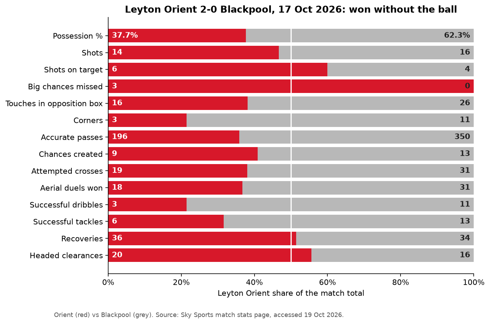
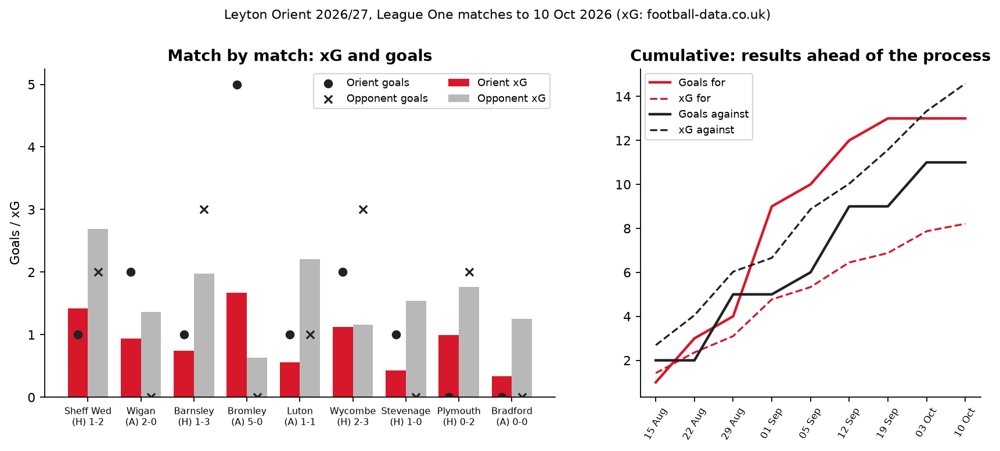
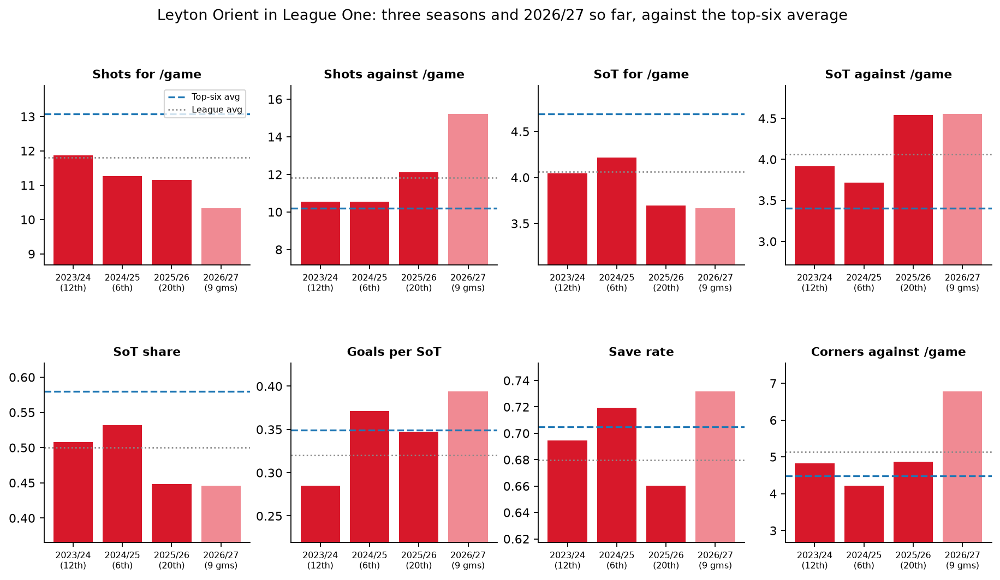
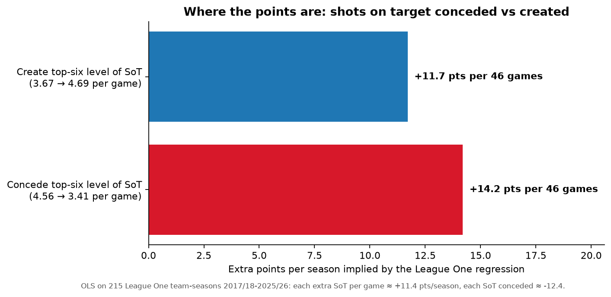
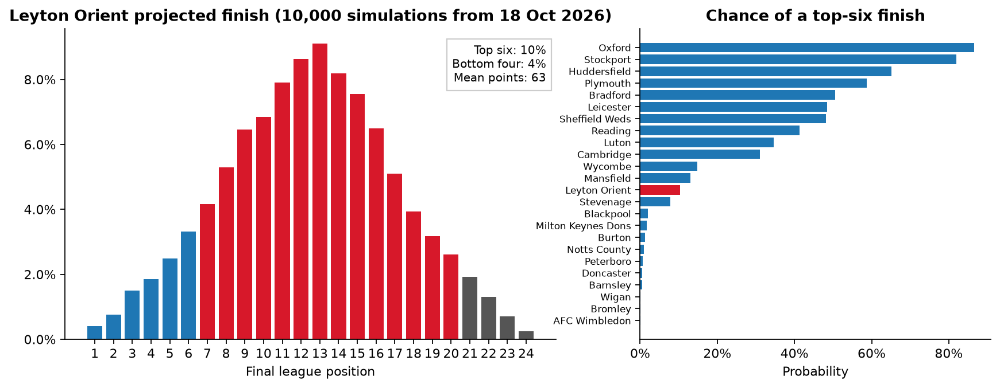

# Leyton Orient: post-match and performance briefing

*Prepared 19 Oct 2026 by Anthony Adusei-Poku. This is independent analysis from public data, not club data. League One table to 17 Oct 2026; match xG and shot data to 10 Oct 2026. PDF version: [`Leyton_Orient_staff_briefing_2026-10-19.pdf`](Leyton_Orient_staff_briefing_2026-10-19.pdf).*

## Key points
* **Blackpool (H) 2-0, 17 Oct:** Orient won with 37.7% possession and 3 corners to 11, but had 6 shots on target to 4 and missed 3 big chances to 0. It was their second clean sheet in a row, after a 0-0 at Bradford in which Bradford had no shots on target.
* **Table vs process:** 9th on 14 points (4W 2D 4L), but **23rd of 24 on xG difference** (−0.71 a game). Over the first 9 games Orient scored 13 from 8.2 xG and conceded 11 from 14.6 xG.
* **Biggest lever: shots on target conceded.** Orient face 4.56 a game, against a top-six average of 3.41. League One history values closing that gap at about **+14 points a season**, more than matching top-six creation (+12).
* **Sustainability risk:** points are being held up by finishing (0.39 goals per shot on target) and saves (0.73 save rate), both above top-six averages. Across 215 League One team-seasons these rates barely carry over from one season to the next, while shot-on-target share does.
* **Projection:** a Dixon-Coles model simulated 10,000 times gives a mean of 63 points, a 10% chance of the top six and a 4% chance of the bottom four. Next up is Reading (A) on Wed 21 Oct, the division's 2nd-best side by xG difference.

## 1. Post-match: Leyton Orient 2-0 Blackpool (Sat 17 Oct 2026)
Goals: Forrester 31' (header from Gilbert's cross), Scarlett 76' (pen). Attendance 8,055.

| | Orient | Blackpool |
|---|---:|---:|
| Possession | 37.7% | 62.3% |
| Shots (on target) | 14 (6) | 16 (4) |
| Big chances missed | 3 | 0 |
| Touches in opposition box | 16 | 26 |
| Corners | 3 | 11 |
| Passes attempted (accuracy) | 271 (72.3%) | 446 (78.5%) |
| Aerial duels won | 18 | 31 |
| Headed clearances | 20 | 16 |

* **Out of possession by design.** Blackpool had the territory but no big chances.
* **Watch-point:** Orient conceded 11 corners here and 11 at Bradford. Across the season they concede 6.8 a game (20th) and win 3.7 (23rd), so set-piece defending is a high-volume task.

## 2. Season so far

* Away: 4 games, 8 points, goals 8-1. Home: 6 games, 6 points, goals 7-10.
* The 5-0 at Bromley (1.67 xG) supplies 4 of the 13 goals in the xG sample.
* Orient take 10.3 shots a game (22nd) at 0.088 xG per shot (league average 0.104), and face 15.2 (19th).

## 3. What drives League One points, and where Orient stand

* **2024/25 (6th, 78 points):** 53% share of shots on target, 0.37 goals per shot on target.
* **2025/26 (20th, 52 points):** share fell to 45%, shots on target conceded rose to 4.5 a game, save rate 0.66. Only 0.87 points a game from 23 matches level at half-time (league average 1.32), roughly 10 points lost.
* **2026/27 (9 games):** 45% share, and 15.2 shots against a game (top-six average 10.2).
* Regression on 215 team-seasons: each extra shot on target a game is worth about **+11.4 points a season**, and each one conceded about **−12.4** (R² 0.67). On current rates it expects 1.14 points a game (52-53 over 46).
* What to trust early: over the first 9 games, shot and shot-on-target shares correlate about 0.49 with points over the rest of the season. Finishing (0.20) and save rate (0.10) are mostly noise.

## 4. Next three fixtures and season outlook
| Date | Fixture | Orient win | Draw | Orient loss | Opponent's xG-difference rank |
|---|---|---:|---:|---:|---:|
| Wed 21 Oct | Reading v Orient | 26% | 24% | 50% | 2nd |
| Sat 24 Oct | Burton v Orient | 36% | 27% | 37% | 22nd |
| Sat 31 Oct | Orient v Cambridge | 40% | 28% | 32% | 18th |

* Projected points: 63 (80% range 53-72). Median finish 13th (80% range 6th-18th). Top six 10%; bottom four 4%.
* The model uses scores only and rates Orient 14th. On xG they rank 23rd, so this outlook is, if anything, generous.
* Out-of-sample test on all 552 League One matches of 2025/26: RPS 0.2184, against 0.2280 for base rates and 0.2097 for the closing betting market.

**Data and limits.** Results, shots, corners, odds and match xG come from football-data.co.uk (free CSVs). The provider of its new 2026/27 xG column is not documented, so I treat xG as indicative. The Orient v Blackpool stats come from the Sky Sports match page and the 15-17 Oct results from Football Web Pages. No shot locations, set-piece tags or player data are freely available for League One. Nine or ten matches is a small sample.
